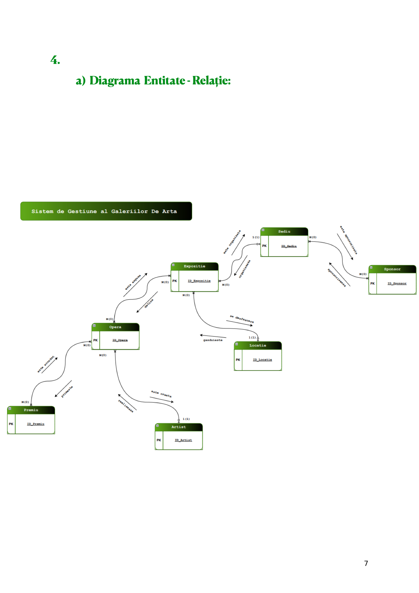
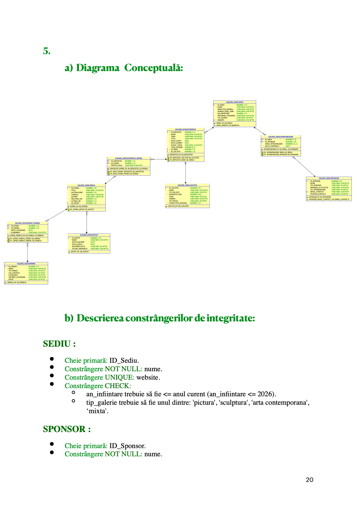
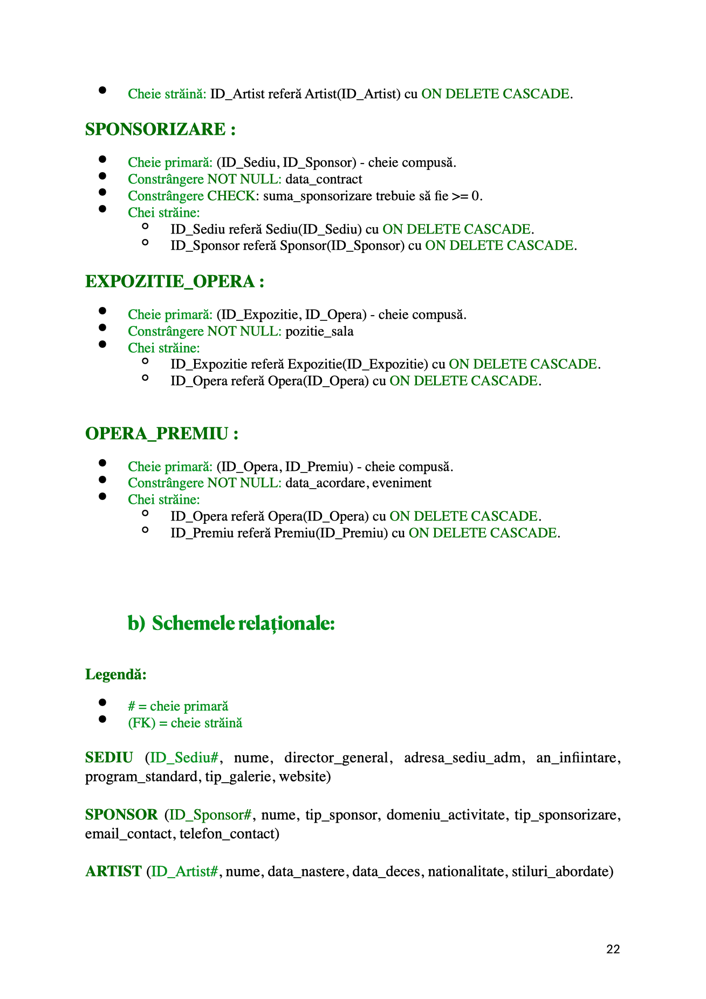

# Art Gallery Management System


Web application for managing galleries, artists, artworks, exhibitions,
locations, sponsors and awards. It combines an interactive frontend with an
Express REST API and an Oracle database, together with JWT authentication,
role-based authorization, secure image uploads, automated tests, Docker
support and CI/CD.

> The academic documentation in `docs/academic/` is an updated English
> version of the original project documentation. Legacy database diagrams are
> preserved below as historical references.

## Features

- Dashboard statistics and server-side reports.
- CRUD operations for the main entities and relationship tables.
- Search, pagination and allowlisted sorting.
- Oracle views and demonstrations of CASCADE and restrictive foreign keys.
- JWT login with username or email.
- bcrypt password hashing and `VIEWER`, `CURATOR` and `ADMIN` roles.
- JPEG, PNG and WebP validation using MIME type and binary signatures.
- Standardized API responses and centralized error handling.
- Helmet, CSP, CORS and authentication rate limiting.
- Jest, Supertest, ESLint, Prettier, coverage, Docker Compose and GitHub Actions.

## Architecture

```text
Browser -> Vanilla JavaScript frontend -> Express REST API -> Oracle Database
                                      ├── Auth and role middleware
                                      ├── Controllers
                                      └── Services and connection pool
```

The frontend communicates with the backend through JSON endpoints. SQL values
use bind variables, while identifiers, reports and views use server-side
allowlists.

## Database diagrams

The following diagrams were extracted from the original academic PDF and are
kept for reference. The current schema additionally includes `USERS` and
`IMAGE_URL`; see [`docs/ERD.md`](docs/ERD.md).

### Entity-relationship diagram



### Conceptual diagram



### Relational schema and constraints



## Technology stack

**Frontend:** HTML5, CSS3, Vanilla JavaScript, Fetch API and Font Awesome  
**Backend:** Node.js, Express, `oracledb`, JWT, bcrypt and Multer  
**Database:** Oracle Database XE  
**Quality and delivery:** Jest, Supertest, ESLint, Prettier, Docker and GitHub Actions

## Requirements

- Node.js 20 or newer;
- npm;
- Oracle Database, locally or through Docker Compose;
- Docker Desktop for the containerized setup.

## Local setup

```bash
npm ci
cp .env.example .env
npm run db:setup
npm run create-admin
npm start
```

The application runs at `http://localhost:3000`. Configure Oracle credentials
and a JWT secret of at least 32 characters in `.env`.

## Environment variables

| Variable | Purpose |
| --- | --- |
| `NODE_ENV` | Runtime environment |
| `PORT` | HTTP server port |
| `DB_USER` / `DB_PASSWORD` | Oracle credentials |
| `DB_CONNECT_STRING` | Oracle connection string |
| `JWT_SECRET` | JWT signing secret |
| `JWT_EXPIRES_IN` | Token lifetime |
| `CORS_ORIGIN` | Allowed origin(s) |
| `UPLOAD_DIR` | Uploaded image directory |
| `MAX_UPLOAD_MB` | Upload size limit |
| `ADMIN_USERNAME` / `ADMIN_EMAIL` | Initial administrator |
| `ADMIN_PASSWORD` | Initial administrator password |

Never commit `.env`, credentials or uploaded files.

## Docker Compose

```bash
cp .env.example .env
# Configure ORACLE_PASSWORD, DB_PASSWORD, ADMIN_PASSWORD and JWT_SECRET
docker compose up --build
docker compose exec app npm run db:setup
docker compose exec app npm run create-admin
```

See [`docs/DEPLOYMENT.md`](docs/DEPLOYMENT.md). Do not run the database reset
against a production database.

## API

Protected requests require:

```http
Authorization: Bearer <jwt>
```

Success responses use `{ "data": ..., "message": "..." }`; paginated lists
also include `pagination`. Errors use an explicit `code`, `message` and
optional `fields`. See [`docs/API.md`](docs/API.md) for all endpoints.

## Tests and quality checks

```bash
npm run format:check
npm run lint
npm test
npm run test:coverage
```

Oracle integration tests are skipped when database variables are unavailable.
GitHub Actions runs formatting, linting and the test suite on every workflow
execution.

## Project structure

```text
├── db/                     # Oracle schema, constraints, views and seed data
├── controllers/            # HTTP handlers
├── middleware/             # Authentication, authorization and errors
├── routes/                 # API routes
├── services/               # Business logic and Oracle access
├── validators/             # Request validation
├── public/                 # Frontend assets
├── tests/                  # Jest and Supertest tests
├── docs/                   # Technical and academic documentation
├── scripts/                # Database and admin scripts
├── app.js                  # Exportable Express application
├── server.js               # Production entry point
├── Dockerfile
└── docker-compose.yml
```

## Security and data integrity

- Passwords are hashed with bcrypt and never returned by the API.
- Protected routes enforce JWT authentication and server-side role checks.
- SQL values use bind variables and identifiers use allowlists.
- Uploads are validated by content type and binary signature.
- Upload filenames are generated server-side.
- Helmet, CSP, CORS and rate limiting are enabled.
- Foreign keys preserve relationship integrity.
- Production configuration rejects weak JWT secrets.

## Roadmap

- [x] Convert the static academic interface into a full-stack application.
- [x] Implement Oracle schema, seed data, views and relationship constraints.
- [x] Add REST CRUD endpoints, search, pagination and reports.
- [x] Add JWT authentication, bcrypt passwords and role-based permissions.
- [x] Add secure image uploads and frontend integration.
- [x] Add automated tests, coverage, Docker and GitHub Actions CI.
- [x] Publish updated English technical and academic documentation.
- [ ] Configure a real Oracle environment and run full database integration tests.
- [ ] Deploy a public demonstration environment with managed secrets.
- [ ] Add production observability, backups and database migration versioning.

## Documentation

- [`docs/academic/Project-Documentation-Updated.md`](docs/academic/Project-Documentation-Updated.md)
  — updated English project documentation.
- [`docs/academic/Chapter-III-Updated.md`](docs/academic/Chapter-III-Updated.md)
  — updated English Chapter III.
- [`docs/API.md`](docs/API.md) — endpoint reference.
- [`docs/ERD.md`](docs/ERD.md) — current data model.
- [`docs/DECISIONS.md`](docs/DECISIONS.md) — architecture decisions.
- [`docs/DEPLOYMENT.md`](docs/DEPLOYMENT.md) — local and Docker deployment.
- [`docs/REPORTS.md`](docs/REPORTS.md) — dashboard and reports.
- [`docs/VIEWS.md`](docs/VIEWS.md) — Oracle views.
- [`docs/CASCADE.md`](docs/CASCADE.md) — cascade behavior.

## License

This project is distributed under the MIT License. See [LICENSE](LICENSE).
