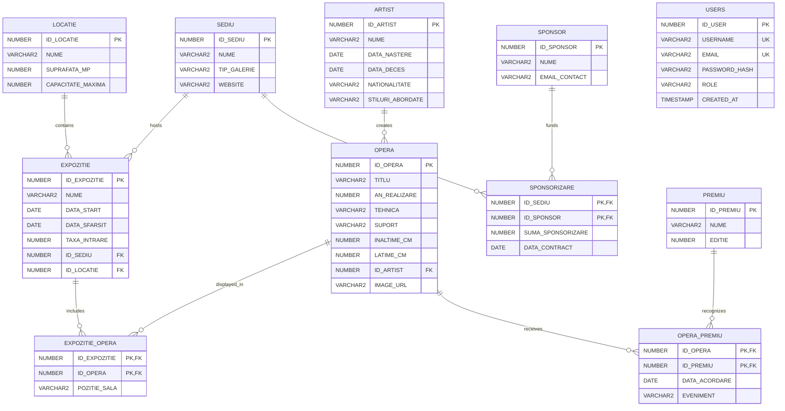

# Entity relationship diagram

> The original academic diagrams are available in the repository and are
> embedded in the README. They are preserved as historical project
> documentation; this Mermaid diagram reflects the current schema, including
> authentication users and artwork image URLs.

`OPERA -> ARTIST`, sponsorship links and exhibition links use `ON DELETE
CASCADE`. Exhibition references to `SEDIU` and `LOCATIE` are restrictive.
